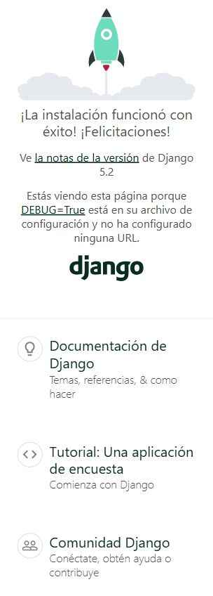
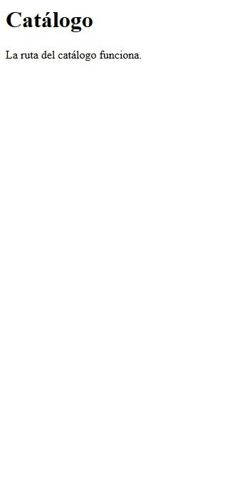
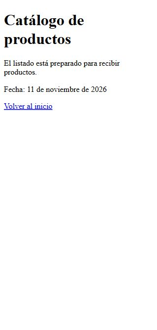
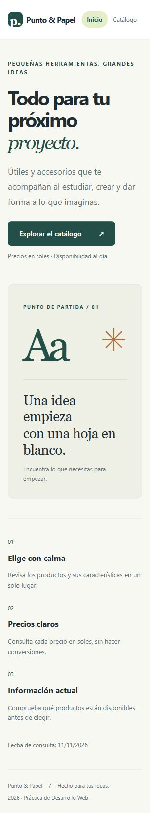
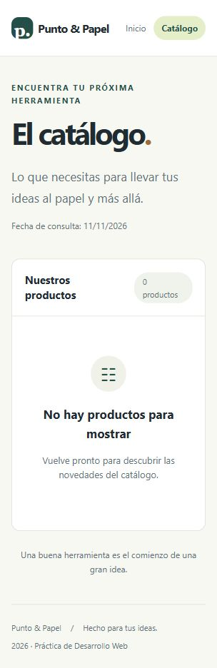
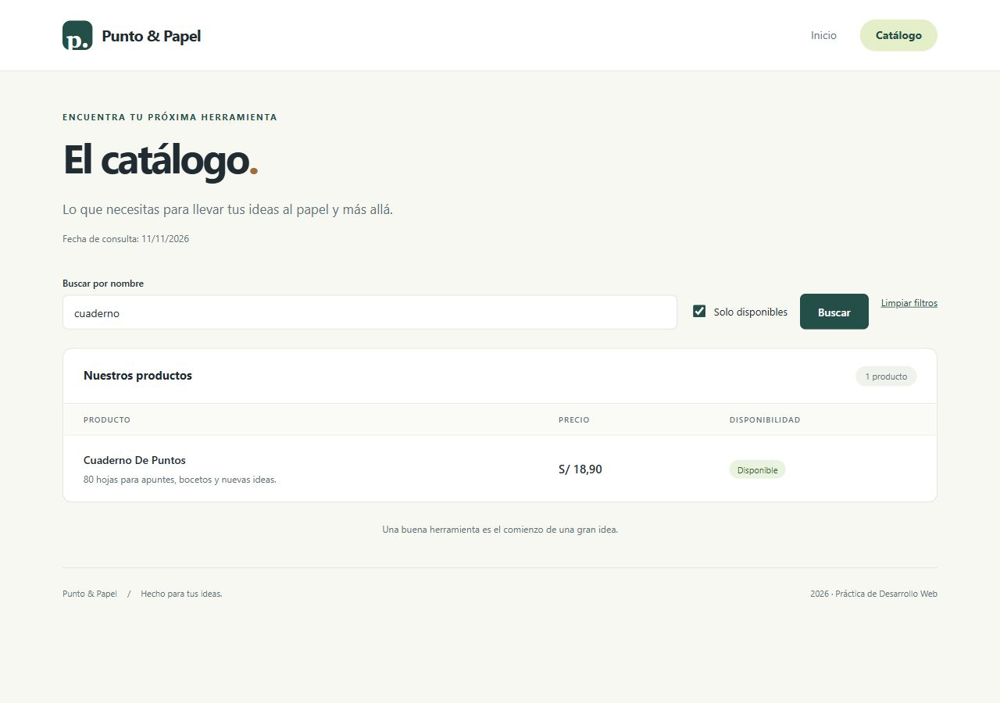

# Evidencias de la práctica

Cada etapa conserva su captura real del navegador y un registro de comprobación.
Las capturas muestran el estado de la aplicación al cerrar ese avance.

## 1. Entorno y proyecto

Preparé el entorno virtual, instalé Django y creé el proyecto con su aplicación.
Después apliqué las migraciones iniciales y comprobé que el servidor mostrara la página de bienvenida.

[Registro de migraciones](01-migraciones.txt) · [Verificación del proyecto](01-verificacion.txt)

## 2. Rutas de la aplicación

Configuré las rutas de inicio y catálogo, conectando las direcciones de la aplicación
con las del proyecto. Comprobé que ambas páginas respondieran correctamente.

[Registro de comprobación de rutas](02-rutas.txt)

## 3. Vistas y contexto

Agregué una vista basada en función para el inicio y otra basada en clase para el
catálogo. Envié el título y la fecha a las páginas; el listado quedó vacío hasta conectar los productos.

[Registro de comprobación de las vistas](03-vistas.txt)

## 4. Plantillas y presentación

Organicé las páginas con una plantilla base para compartir el diseño y la navegación.
Utilicé bloques, condiciones, recorridos y filtros para presentar la información, además de un mensaje para el catálogo vacío.

[Registro de comprobación de plantillas](04-plantillas.txt)

## 5. Modelo, migraciones y consultas

Creé el modelo Producto, apliqué su migración y guardé seis productos en SQLite mediante
el ORM. Comprobé las consultas para listar y filtrar los datos, y agregué la búsqueda por nombre y disponibilidad.

[Migración del modelo](05-migraciones.txt) · [Consultas del ORM](05-datos.txt) · [Ocho pruebas aprobadas](05-pruebas.txt)

La base `db.sqlite3` se genera localmente y no se incluye en los commits.

Revisión visual: escritorio a 1280 px y móvil a 390 px. La página móvil no
desborda el ancho de pantalla; la tabla permite desplazamiento horizontal.
La búsqueda «cuaderno» junto con «Solo disponibles» devuelve un producto;
«sin coincidencias» muestra el mensaje vacío, y «Limpiar filtros» restaura los seis.

## Capturas por avance

| Avance | Captura |
| --- | --- |
| Entorno | [Proyecto funcionando](01-proyecto.jpg) |
| Rutas | [Ruta del catálogo](02-rutas.jpg) |
| Vistas | [Listado con contexto](03-vistas.jpg) |
| Plantillas | [Inicio](04-inicio.jpg) · [Catálogo vacío](04-plantillas.jpg) |
| Productos | [Listado completo](05-productos.jpg) |
| Consultas | [Filtros combinados](05-filtro.jpg) · [Sin resultados](05-sin-resultados.jpg) |
| Adaptación | [Vista móvil](05-movil.jpg) |

## Registro de asistencia

El desarrollo se realiza con asistencia de IA por solicitud del estudiante.
No se declara que el 75 % del código haya sido escrito manualmente.
La guía exige ese porcentaje: el estudiante debe revisar y reproducir el trabajo
manualmente para cumplirlo. Los registros de ejecución corresponden a verificaciones reales.

### Incidencias resueltas con IA

`# IA: estilos nuevos sin cargar en runserver → Solución manual: comprobar findstatic y reiniciar la recarga del servidor para que descubra el nuevo directorio static.`

Conservo las capturas iniciales con sufijo `sin-estilos` y agrego las versiones
verificadas tras recargar el servidor.

`# IA: DisallowedHost al verificar las vistas en shell → Solución manual: permitir localhost con override_settings únicamente dentro de la comprobación; conservar settings.py sin cambios.`

La solución anterior fue aplicada por IA; se registra como explicación para su revisión
y reproducción manual, no como una intervención manual ya realizada por el estudiante.
