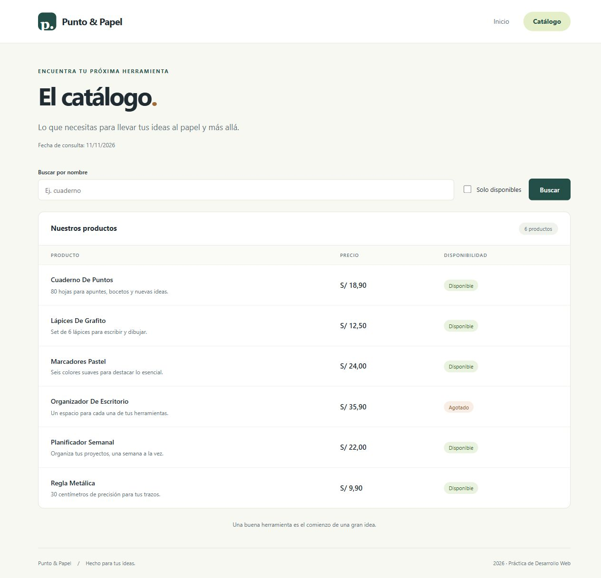

# Evidencias de la práctica

Cada etapa conserva su captura real del navegador y un registro de comprobación.
Las capturas muestran el estado de la aplicación al cerrar ese avance.

## 1. Entorno y proyecto

- Creo el entorno virtual e instalo Django 5.2.
- Inicio el proyecto `config` y la aplicación `catalogo`.
- Registro la aplicación y aplico las migraciones iniciales de Django.
- Verifico el proyecto antes de iniciar el servidor local.
- Captura: `01-proyecto.jpg`.

## 2. Rutas de la aplicación

- Conecto `catalogo.urls` mediante `include()` y nombro las rutas.
- Compruebo `reverse()`, `resolve()` y las respuestas HTTP de inicio y catálogo.
- Captura: `02-rutas.jpg`.

## 3. Vistas y contexto

- Implemento `home` como FBV con `render()`.
- Implemento `ProductoListView` y agrego título y fecha con `get_context_data()`.
- Uso temporalmente una lista vacía hasta definir el modelo del paso 5.
- Captura: `03-vistas.jpg`.

## 4. Plantillas y presentación

- Comparto la estructura mediante `base.html`, `extends` y bloques.
- Uso `for`, `if`, `url`, `static` y los filtros `title`, `date` y `floatformat`.
- Agrego estilos adaptables y un mensaje cuando el catálogo está vacío.
- Capturas: `04-plantillas.jpg` y `04-inicio.jpg`.

## 5. Modelo, migraciones y consultas

- Defino `Producto`, su representación de texto y la validación del precio.
- Creo y aplico la migración; agrego seis productos mediante el ORM.
- Compruebo `all()` y `filter()`, búsqueda y disponibilidad combinadas.
- Verifico las vistas, el escape de texto, el precio y el poblado repetible con pruebas.
- Capturas: `05-productos.jpg`, `05-filtro.jpg`, `05-sin-resultados.jpg` y `05-movil.jpg`.
- La base `db.sqlite3` se genera localmente y no se incluye en los commits.

Revisión visual: escritorio a 1280 px y móvil a 390 px. La página móvil no
desborda el ancho de pantalla; la tabla permite desplazamiento horizontal.
La búsqueda «cuaderno» junto con «Solo disponibles» devuelve un producto;
«sin coincidencias» muestra el mensaje vacío, y «Limpiar filtros» restaura los seis.

## Capturas por avance

| Avance | Captura |
| --- | --- |
| Entorno | [Proyecto funcionando](01-proyecto.jpg) |
| Rutas | [Ruta del catálogo](02-rutas.jpg) |
| Vistas | [Listado con contexto](03-vistas.jpg) |
| Plantillas | [Inicio](04-inicio.jpg) · [Catálogo vacío](04-plantillas.jpg) |
| Productos | [Listado completo](05-productos.jpg) |
| Consultas | [Filtros combinados](05-filtro.jpg) · [Sin resultados](05-sin-resultados.jpg) |
| Adaptación | [Vista móvil](05-movil.jpg) |

## Registro de asistencia

El desarrollo se realiza con asistencia de IA por solicitud del estudiante.
No se declara que el 75 % del código haya sido escrito manualmente.
La guía exige ese porcentaje: el estudiante debe revisar y reproducir el trabajo
manualmente para cumplirlo. Los registros de ejecución corresponden a verificaciones reales.

### Incidencias resueltas con IA

`# IA: estilos nuevos sin cargar en runserver → Solución manual: comprobar findstatic y reiniciar la recarga del servidor para que descubra el nuevo directorio static.`

Conservo las capturas iniciales con sufijo `sin-estilos` y agrego las versiones
verificadas tras recargar el servidor.

`# IA: DisallowedHost al verificar las vistas en shell → Solución manual: permitir localhost con override_settings únicamente dentro de la comprobación; conservar settings.py sin cambios.`

La solución anterior fue aplicada por IA; se registra como explicación para su revisión
y reproducción manual, no como una intervención manual ya realizada por el estudiante.
